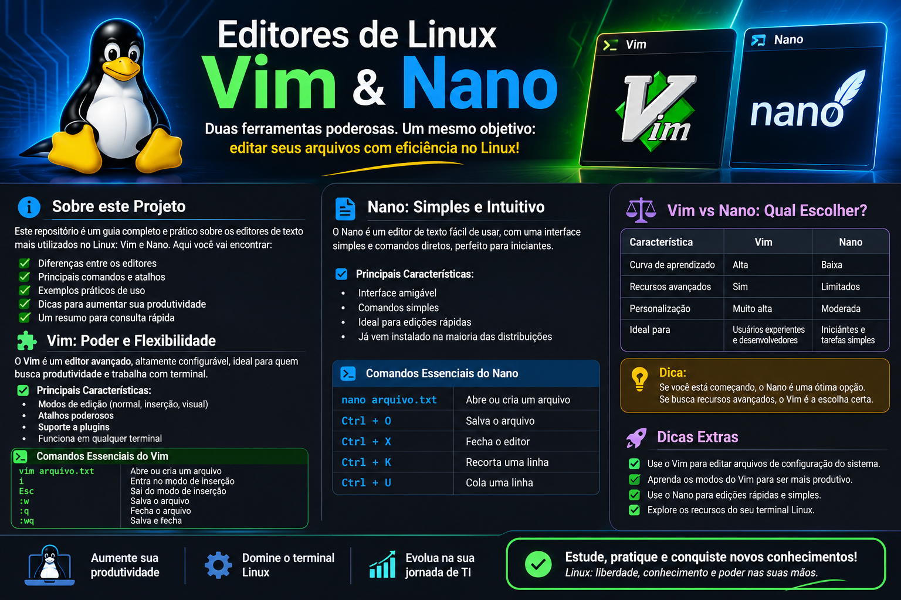

# 🐧 Editores de Texto Linux: Vim & Nano




## 📌 Sobre o projeto

Este repositório apresenta um guia técnico e prático sobre dois dos editores de texto mais conhecidos do ambiente Linux: **Vim e Nano**.

Os editores de terminal são ferramentas fundamentais para profissionais de infraestrutura, administração de sistemas, DevOps, Cloud Computing e Segurança da Informação.

Por meio deles, é possível criar, consultar e modificar arquivos diretamente pelo terminal, inclusive em servidores Linux sem interface gráfica.

O objetivo deste material é apresentar os conceitos fundamentais, demonstrar os principais comandos e desenvolver familiaridade com a edição de arquivos no ambiente Linux.

## 🎯 Objetivos de aprendizagem

- Compreender a importância dos editores de texto no Linux.
- Conhecer as diferenças entre Vim e Nano.
- Aprender a criar e editar arquivos pelo terminal.
- Dominar os principais comandos e atalhos.
- Entender os modos de operação do Vim.
- Utilizar o Nano para edições rápidas.
- Desenvolver habilidades importantes para administração Linux.

---

# 1. Introdução aos editores de texto Linux

No Linux, diversos arquivos de configuração são armazenados em formato de texto.

Esses arquivos podem controlar configurações de rede, usuários, permissões, serviços, aplicações e componentes do sistema operacional.

Os editores Vim e Nano permitem modificar esses arquivos diretamente pelo terminal.

**Por que aprender esses editores?**

- Administração de servidores Linux.
- Gerenciamento de arquivos de configuração.
- Configuração de serviços.
- Desenvolvimento de scripts.
- Automação de tarefas.
- Atividades de infraestrutura e segurança da informação.

# 2. Nano — Simplicidade e praticidade

O Nano é um editor de texto baseado em terminal, conhecido por sua interface simples e facilidade de utilização.

É uma excelente opção para quem está começando a trabalhar com Linux.

## 2.1 Características do Nano

- Interface intuitiva.
- Comandos apresentados na parte inferior da tela.
- Fácil utilização.
- Edição rápida de arquivos.
- Recursos de busca e substituição.
- Ideal para usuários iniciantes.

## 2.2 Como abrir o Nano

Para abrir ou criar um arquivo:

```bash
nano arquivo.txt
```

Se o arquivo não existir, o Nano permitirá criá-lo.

## 2.3 Principais atalhos do Nano

| Atalho | Função |
|---|---|
| Ctrl + O | Salvar arquivo |
| Ctrl + X | Sair do editor |
| Ctrl + W | Pesquisar texto |
| Ctrl + K | Recortar linha |
| Ctrl + U | Colar texto |
| Ctrl + G | Abrir ajuda |
| Ctrl + \ | Localizar e substituir |
| Ctrl + C | Mostrar posição do cursor |
| Ctrl + _ | Ir para uma linha específica |

## 2.4 Exemplo prático

Criando um arquivo:

```bash
nano configuracao.txt
```

Digite:

```text
Sistema Operacional: Linux
Editor: Nano
Objetivo: Aprender edição de arquivos
Ambiente: Terminal
```

Para salvar:

1. Pressione `Ctrl + O`.
2. Pressione `Enter` para confirmar o nome.
3. Pressione `Ctrl + X` para sair.

Para visualizar o arquivo:

```bash
cat configuracao.txt
```

# 3. Vim — Poder e flexibilidade

O Vim é um editor de texto avançado, baseado no editor Vi.

É amplamente utilizado por administradores de sistemas, desenvolvedores e profissionais que trabalham frequentemente com terminais Linux.

Seu principal diferencial é a utilização de diferentes modos de operação.

## 3.1 Características do Vim

- Edição baseada em modos.
- Grande quantidade de atalhos.
- Recursos avançados de navegação.
- Busca e substituição de textos.
- Personalização por configurações e plugins.
- Capacidade de trabalhar com múltiplos arquivos.

## 3.2 Como abrir o Vim

```bash
vim arquivo.txt
```

Para criar ou abrir um arquivo:

```bash
vim configuracao.txt
```

## 3.3 Os principais modos do Vim

O Vim trabalha principalmente com três modos:

**1. Modo Normal**

É o modo padrão do Vim.

Permite navegar pelo documento, executar comandos e manipular textos.

**2. Modo de Inserção**

Permite digitar e editar conteúdo.

Para entrar nesse modo:

```text
i
```

**3. Modo Visual**

Permite selecionar trechos do texto.

Para entrar nesse modo:

```text
v
```

## 3.4 Principais comandos do Vim

| Comando | Função |
|---|---|
| i | Entrar no modo de inserção |
| Esc | Voltar ao modo normal |
| v | Entrar no modo visual |
| :w | Salvar arquivo |
| :q | Sair do editor |
| :wq | Salvar e sair |
| :q! | Sair sem salvar alterações |
| dd | Excluir linha |
| yy | Copiar linha |
| p | Colar conteúdo copiado |
| u | Desfazer última alteração |
| /texto | Pesquisar uma palavra |
| n | Próxima ocorrência |
| gg | Ir para o início do arquivo |
| G | Ir para o final do arquivo |

## 3.5 Exemplo prático

Abra o arquivo:

```bash
vim configuracao.txt
```

Pressione:

```text
i
```

Digite:

```text
Sistema Operacional: Linux
Editor: Vim
Objetivo: Aprender edição de arquivos
Ambiente: Terminal
```

Para salvar e sair:

1. Pressione `Esc`.
2. Digite `:wq`.
3. Pressione `Enter`.

Para visualizar:

```bash
cat configuracao.txt
```

## 3.6 Tutorial interativo do Vim

O próprio Vim possui um tutorial para iniciantes.

Execute:

```bash
vimtutor
```

Esse comando inicia uma sequência de exercícios práticos para aprender os principais recursos do editor.

# 4. Comparação entre Vim e Nano

| Característica | Vim | Nano |
|---|---|---|
| Facilidade inicial | Mais complexa | Mais simples |
| Interface | Baseada em modos | Mais intuitiva |
| Atalhos | Comandos próprios | Atalhos Ctrl |
| Personalização | Avançada | Mais limitada |
| Produtividade | Alta após aprendizado | Alta para edições rápidas |
| Público | Usuários experientes e iniciantes dispostos a aprender | Iniciantes e usuários em geral |
| Uso em servidores | Sim | Sim |

**Qual escolher?**

O Nano é recomendado para quem deseja realizar edições simples e rápidas.

O Vim é recomendado para quem deseja desenvolver domínio avançado sobre edição de textos pelo terminal.

Conhecer os dois é uma vantagem para quem trabalha com Linux.

# 5. Instalação dos editores

Dependendo da distribuição Linux, os editores podem já estar instalados.

## Ubuntu e Debian

Instalar Nano:

```bash
sudo apt update
sudo apt install nano -y
```

Instalar Vim:

```bash
sudo apt install vim -y
```

## Fedora

Instalar Nano:

```bash
sudo dnf install nano -y
```

Instalar Vim:

```bash
sudo dnf install vim-enhanced -y
```

## Arch Linux

Instalar Nano:

```bash
sudo pacman -S nano
```

Instalar Vim:

```bash
sudo pacman -S vim
```

## Verificar a instalação

```bash
vim --version
```

```bash
nano --version
```

# 6. Exercícios práticos

A melhor maneira de aprender é praticar.

Os exercícios abaixo podem ser realizados em uma máquina virtual Linux ou em um ambiente de laboratório.

### Exercício 1 — Criando um arquivo com Nano

1. Abra o terminal.
2. Execute `nano meu-primeiro-arquivo.txt`.
3. Escreva uma descrição sobre seu ambiente Linux.
4. Salve o arquivo.
5. Consulte o conteúdo utilizando `cat`.

### Exercício 2 — Editando um arquivo com Vim

1. Execute `vim laboratorio.txt`.
2. Entre no modo de inserção com `i`.
3. Escreva três linhas de texto.
4. Pressione `Esc`.
5. Salve utilizando `:wq`.

### Exercício 3 — Navegação no Vim

1. Abra um arquivo com várias linhas.
2. Utilize `gg` para ir ao início.
3. Utilize `G` para ir ao final.
4. Utilize `/palavra` para pesquisar um termo.
5. Utilize `n` para encontrar a próxima ocorrência.

### Exercício 4 — Comparando os editores

Crie o mesmo arquivo utilizando Nano e Vim.

Observe as diferenças entre os comandos, a interface e o processo de edição.

# 7. Boas práticas

- Sempre confira o arquivo antes de alterar configurações importantes.
- Mantenha cópias de segurança dos arquivos de configuração.
- Utilize permissões adequadas ao editar arquivos administrativos.
- Evite modificar arquivos do sistema sem compreender sua finalidade.
- Pratique os comandos em ambientes de laboratório.
- Aprenda os atalhos mais utilizados para melhorar sua produtividade.

**Dica:** antes de modificar um arquivo importante, você pode criar uma cópia:

```bash
cp arquivo.conf arquivo.conf.bak
```

# 8. Conclusão

Conhecer os editores Vim e Nano é um passo importante para desenvolver habilidades no ambiente Linux.

Embora apresentem diferenças na interface e na forma de utilização, ambos possuem uma função essencial: permitir a edição eficiente de arquivos diretamente pelo terminal.

Para quem está construindo uma trajetória profissional em Infraestrutura de TI, Cloud Computing e Segurança da Informação, dominar essas ferramentas representa uma base importante para trabalhar com servidores e sistemas Linux.

**Aprender Linux não significa apenas conhecer comandos. Significa compreender o ambiente, administrar recursos e desenvolver autonomia técnica.**

---

## 📚 Referências para estudo

- Documentação oficial do Vim: https://www.vim.org/docs.php
- Wiki do Vim: https://vim.fandom.com/wiki/Vim_Tips_Wiki
- Site oficial do GNU Nano: https://www.nano-editor.org/
- Documentação Ubuntu: https://help.ubuntu.com/
- Linux Documentation Project: https://tldp.org/

## 🛠️ Tecnologias e ferramentas

- Linux
- Terminal
- Vim
- GNU Nano
- Shell

## 👨‍💻 Autor

Projeto desenvolvido como parte dos estudos práticos em Linux, Infraestrutura de TI, Cloud Computing e Segurança da Informação.

**Objetivo:** construir uma base técnica sólida por meio de estudos, laboratórios e documentação prática.

---

⭐ Se este material foi útil, considere deixar uma estrela no repositório!
